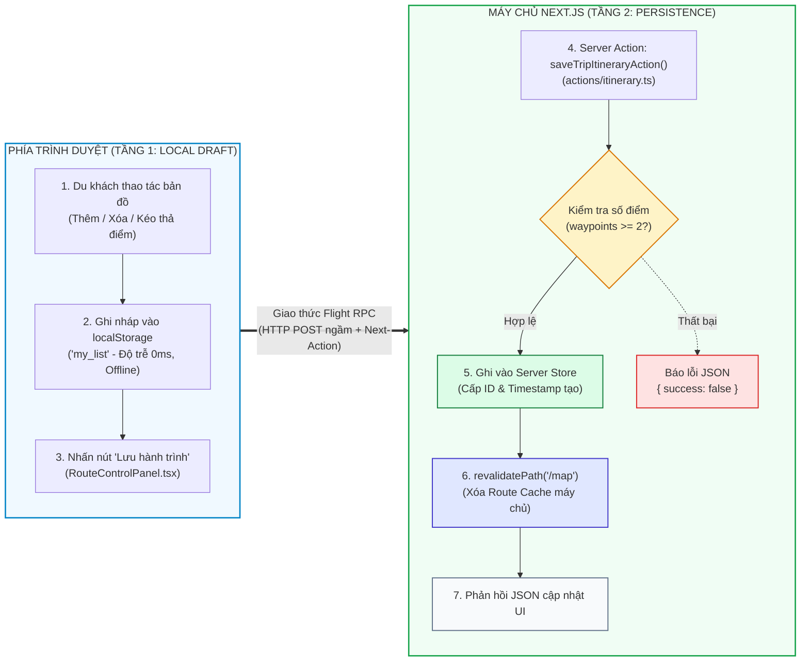

# HƯỚNG DẪN HOÀN THIỆN VÀ BIÊN SOẠN LẠI CHƯƠNG 7

**Đề tài:** Tìm hiểu công nghệ Next.js và ứng dụng xây dựng Hệ thống lập lộ trình du lịch với VIETMAP API  
**Môn học:** Các công nghệ lập trình hiện đại  
**Giảng viên hướng dẫn:** TS. Phạm Thi Vương  
**Chương 7:** Cơ chế giao tiếp máy chủ bằng Route Handlers và Server Actions  

---

## I. TỔNG HỢP VẤN ĐỀ CẦN KHẮC PHỤC THEO GÓP Ý CỦA GIẢNG VIÊN

| STT | Vấn đề Giảng viên chỉ ra | Bản chất kỹ thuật trong Next.js 16 | Cách giải trình & Sửa đổi trong Báo cáo |
| :---: | :--- | :--- | :--- |
| **1** | **Chưa rõ `saveTripItineraryAction` lưu ở đâu?** | Tránh lầm lẫn giữa bộ nhớ tạm client và lưu trữ máy chủ. Đồ án áp dụng **Mô hình lưu trữ 2 tầng (Two-tier Storage Architecture)**. | **Tầng 1 (Client):** `localStorage` đóng vai trò Local Draft (nháp offline, độ trễ 0ms).<br>**Tầng 2 (Server):** Server Action tiếp nhận dữ liệu trên Node.js Server và lưu vào `serverDb` (Server Persistence Store). |
| **2** | **`revalidatePath('/map')` làm mới cái gì?** | Trang `/map` có Server Component vỏ ngoài (`MapPage`) và Client Component (`MapContainer`). Khi gọi `revalidatePath`, Next.js xóa cache tĩnh và làm mới Router Cache. | Giải thích cơ chế: Next.js **Purge Full Route Cache** trên server và gửi tín hiệu cập nhật **Router Cache** phía client để đồng bộ UI mà **không cần reload (F5) toàn bộ trang**, bảo toàn trạng thái bản đồ. |
| **3** | **Chưa cảnh báo bảo mật Server Action POST** | Server Action bản chất là một **HTTP POST Endpoint công khai** do Next.js sinh ngầm qua header `Next-Action`. | Bổ sung mục **7.3.3** phân tích an ninh mạng: Phân tích cơ chế Flight RPC, cảnh báo nguy cơ bị spam POST trực tiếp bằng cURL/Postman, và giải pháp phòng vệ (Host/Origin check, Rate Limiting, Authentication). |
| **4** | **Có bị "dính sang Backend" không?** | Không. Next.js là Full-stack React Framework hoạt động theo mô hình **BFF (Backend For Frontend)**. | Khẳng định rõ: Nhóm không dựng backend riêng biệt (không dùng Spring Boot/Express hay cài CSDL PostgreSQL/Prisma đồ sộ làm lệch đề tài). Trọng tâm nghiên cứu là **cơ chế giao tiếp máy chủ nguyên bản của Next.js 16**. |

---

## II. SƠ ĐỒ MÔ HÌNH LƯU TRỮ 2 TẦNG (BỐ CỤC NGANG 2 CỘT)

Sơ đồ được thiết kế theo dạng **2 cột song song đặt ngang nhau** (`flowchart LR`), bên trong mỗi cột các bước chạy dọc (`direction TB`), vừa vặn trên khổ giấy Word/PDF:



---

## III. MÃ NGUỒN CHUẨN XÁC TINH GỌN (CHỤP ẢNH ĐƯA VÀO HÌNH 7.4)

Mã nguồn tệp `travel-website/actions/itinerary.ts` (đã tối ưu chỉ 38 dòng, chụp vừa vặn một khung hình):

```typescript
'use server';

import { revalidatePath } from "next/cache";

export interface Waypoint { name: string; lat: number; lng: number; }
export interface SaveItineraryInput {
  tripName?: string;
  waypoints: Waypoint[];
  vehicle?: string;
  distanceKm?: number;
  durationMin?: number;
}

// Kho lưu trữ dữ liệu phía máy chủ (Server Persistence Store)
const serverDb: Array<SaveItineraryInput & { id: string; createdAt: string }> = [];

export async function saveTripItineraryAction(input: SaveItineraryInput) {
  try {
    const { tripName, waypoints, vehicle = "car", distanceKm = 0, durationMin = 0 } = input;

    if (!waypoints || waypoints.length < 2) {
      return { success: false, message: "Hành trình cần ít nhất 2 điểm dừng." };
    }

    // 1. Ghi nhận dữ liệu vào Server Persistence Store
    const record = {
      id: `trip_${Date.now()}`,
      tripName: tripName || `Lộ trình ${waypoints[0].name} - ${waypoints[waypoints.length - 1].name}`,
      waypoints,
      vehicle,
      distanceKm: Number(distanceKm.toFixed(2)),
      durationMin: Math.round(durationMin),
      createdAt: new Date().toISOString(),
    };
    serverDb.push(record);

    console.log(`[Server Action] Đã lưu hành trình: "${record.tripName}" (ID: ${record.id})`);

    // 2. Làm tươi Full Route Cache và Router Cache của route /map
    revalidatePath("/map");
    return { success: true, message: `Đã lưu thành công hành trình "${record.tripName}"!`, data: record };
  } catch (err) {
    return { success: false, message: "Có lỗi xảy ra trên máy chủ." };
  }
}
```

---

## IV. NỘI DUNG VĂN BẢN CHI TIẾT BIÊN SOẠN LẠI CHO CHƯƠNG 7

### 7.1. Bối cảnh và lý do lựa chọn giải pháp
*(Giữ nguyên nội dung trang 1 trong bản PDF hiện tại, nhấn mạnh 2 luồng: Reverse Proxy cho API bên thứ ba và Data Mutation cho nghiệp vụ nội bộ).*

---

### 7.2. Nguyên lý vận hành và cơ chế kỹ thuật
*(Giữ nguyên 7.2.1 và 7.2.2 trong bản PDF, thay thế Hình 7.1 bằng Sơ đồ Mermaid Mục II ở trên).*

---

### 7.3. Thực thi trong kiến trúc mã nguồn ứng dụng

#### 7.3.1. Ứng dụng Route Handler làm trạm ủy quyền gợi ý địa điểm
*(Giữ nguyên mã nguồn Route Handler Autocomplete và ảnh minh chứng ở trang 3).*

#### 7.3.2. Ứng dụng Server Action trong nghiệp vụ lưu hành trình du lịch
*(Viết lại trang 4 theo nội dung dưới đây):*

Khác với các truy vấn đọc dữ liệu bản đồ, thao tác lưu trữ kế hoạch chuyến đi của du khách thuộc nhóm nghiệp vụ **Data Mutation** (Biến đổi dữ liệu trạng thái). Để đảm bảo trải nghiệm mượt mà đồng thời duy trì tính toàn vẹn phía máy chủ, ứng dụng triển khai **Mô hình lưu trữ 2 tầng (Two-tier Storage Architecture)**:

1. **Tầng 1 – Local Offline Draft (Client):** Khi người dùng chọn và thay đổi các điểm dừng trên bản đồ, dữ liệu được lưu tạm thời vào `localStorage` (`my_list`). Cơ chế này giúp du khách thao tác liên tục với độ trễ 0ms mà không làm nghẽn đường truyền mạng.
2. **Tầng 2 – Server Persistence Store (Server):** Khi người dùng nhấn nút *"Lưu"* trên giao diện `RouteControlPanel.tsx`, ứng dụng kích hoạt Server Action `saveTripItineraryAction(input)`. 
   - Hàm này thực thi hoàn toàn trong môi trường Node.js Server của Next.js 16.
   - Dữ liệu được kiểm tra hợp lệ tối thiểu ($\ge 2$ điểm dừng) và tự động chuẩn hóa tên lộ trình.
   - Bản ghi được cấp phát mã định danh duy nhất (`id: trip_<timestamp>`) cùng thời gian tạo (`createdAt`), sau đó lưu trữ bền vững vào `serverDb` trên máy chủ.
   - **Bản chất của lệnh `revalidatePath('/map')`:** Lệnh này yêu cầu Next.js xóa bản cache tĩnh cũ trong **Full Route Cache** và kích hoạt cơ chế làm tươi **Router Cache** phía máy khách, giúp giao diện người dùng đồng bộ trạng thái lưu thành công mà **không cần thực hiện thao tác tải lại toàn trang (F5/hard reload)**, giữ nguyên vị trí bản đồ hiện tại.

*(Chèn Hình 7.4 trích từ file `actions/itinerary.ts` tinh gọn 38 dòng ở Mục III).*  
*(Chèn Hình 7.5 log terminal và Hình 7.6 giao diện nút Lưu thành công).*

---

#### 7.3.3. Phân tích khía cạnh an ninh mạng của Server Action (MỤC BỔ SUNG MỚI)

Mặc dù Server Action được viết và gọi như một hàm JavaScript nội bộ, nhưng về bản chất kiến trúc mạng của Next.js:

1. **Cơ chế Endpoint POST ngầm định:** Khi khai báo chỉ thị `'use server'`, trình biên dịch Next.js tự động tạo ra một **điểm cuối HTTP POST công khai (Public HTTP Endpoint)** được định danh qua header `Next-Action`. Kẻ xấu hoàn toàn có thể dùng cURL hoặc Postman để gửi trực tiếp yêu cầu POST lên endpoint này mà không cần thông qua giao diện web.
2. **Nguy cơ tiềm ẩn:**
   - *Bypass kiểm tra Client:* Dữ liệu giả mạo (danh sách điểm rỗng, tọa độ sai lệch) có thể được gửi thẳng lên server nếu server không có lớp kiểm tra.
   - *Tấn công làm nghẽn tài nguyên (Resource Exhaustion DoS):* Việc liên tục gửi request kích hoạt `revalidatePath` có thể làm tăng tải CPU của máy chủ khi phải liên tục tính toán lại cache.
3. **Giải pháp phòng vệ theo kiến trúc Next.js (Defense-in-Depth):**
   - *CSRF Protection tích hợp:* Next.js tự động đối soát Header `Origin` và `Host` để từ chối các request giả mạo tên miền.
   - *Server-side Validation:* Bắt buộc kiểm tra dữ liệu tại máy chủ (`waypoints.length >= 2`).
   - *Đề xuất cho môi trường Production thực tế:* Áp dụng Rate Limiting (giới hạn tần suất gọi Action theo IP) và xác thực người dùng (Authentication qua Auth.js / NextAuth).

---

### 7.4. Đánh giá và so sánh đối chiếu chuyên sâu

Thay thế Bảng 7.1 bằng bảng chuẩn hóa đã bổ sung các tiêu chí về an ninh và lưu trữ:

| Tiêu chí so sánh | Route Handler (`app/api/.../route.ts`) | Server Action (`actions/...ts` có `'use server'`) |
| :--- | :--- | :--- |
| **Mô hình kiến trúc** | RESTful HTTP Endpoint | RPC (Remote Procedure Call) qua Flight Protocol |
| **Định danh đường dẫn** | Có URL công khai cố định (vd: `/api/vietmap/autocomplete`) | Không có URL cố định; dùng mã băm ngầm trong Header `Next-Action` |
| **Mục đích chính trong đồ án** | Làm Reverse Proxy bảo mật ẩn `VIETMAP_API_KEY` cho dịch vụ bản đồ | Thực hiện Data Mutation lưu trữ và đồng bộ hành trình du lịch |
| **Cách thức gọi từ Client** | Dùng hàm `fetch('/api/...')` và giải mã JSON | Import và gọi trực tiếp như hàm `async` JavaScript thông thường |
| **Bảo mật & Nguy cơ** | Cần cấu hình CORS nếu gọi từ bên ngoài | Cần lưu ý bản chất là endpoint POST ngầm; Next.js tích hợp sẵn bảo vệ CSRF |
| **Đồng bộ hóa giao diện** | Client tự quản lý state hoặc gọi fetch lại | Hỗ trợ hàm `revalidatePath('/map')` tự động làm tươi Route Cache phía server |
| **Phù hợp nghiệp vụ** | Tích hợp dịch vụ bên thứ ba (Web APIs, Webhook) | Thao tác Form, thêm/sửa/xóa dữ liệu chuyến đi, lưu trữ trạng thái người dùng |
