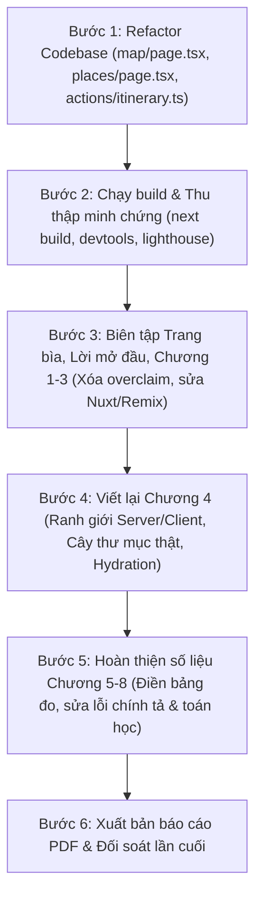

# KẾ HOẠCH CHI TIẾT KHẮC PHỤC LỖI BÁO CÁO CNLTHĐ (THEO GÓP Ý CỦA GIẢNG VIÊN)

**Đề tài:** Tìm hiểu công nghệ Next.js và ứng dụng xây dựng Hệ thống lập lộ trình du lịch với VIETMAP API  
**Môn học:** Các công nghệ lập trình hiện đại  
**Giảng viên hướng dẫn:** TS. Phạm Thi Vương  
**Dự án đối soát thực tế:** `travel-website` (Next.js 16.3.5, React 19.2.8, Leaflet 1.9.4, VietMap API v4)

---

## MỤC LỤC
1. [BẢNG ĐỐI SOÁT TỔNG HỢP HIỆN TRẠNG (BÁO CÁO VS MÃ NGUỒN REPO VS GÓP Ý)](#1-bảng-đối-soát-tổng-hợp-hiện-trạng)
2. [CHI TIẾT PHƯƠNG ÁN KHẮC PHỤC 10 GÓP Ý](#2-chi-tiết-phương-án-khắc-phục-10-góp-ý)
   - [Góp ý 1: Điểm làm tốt (Duy trì & làm chuẩn mực)](#góp-ý-1-điểm-làm-tốt-duy-trì--làm-chuẩn-mực)
   - [Góp ý 2: Thống nhất ranh giới Server / Client Component & Cây thư mục](#góp-ý-2-thống-nhất-ranh-giới-server--client-component--cây-thư-mục)
   - [Góp ý 3: Khắc phục lỗi sai kiến trúc & Overclaim tại Mục 3.3](#góp-ý-3-khắc-phục-lỗi-sai-kiến-trúc--overclaim-tại-mục-33)
   - [Góp ý 4: Bổ sung cấu hình và minh chứng Next.js 16](#góp-ý-4-bổ-sung-cấu-hình-và-minh-chứng-nextjs-16)
   - [Góp ý 5: Thí nghiệm Caching (Chương 5) – Bóc tách các tầng cache](#góp-ý-5-thí-nghiệm-caching-chương-5--bóc-tách-các-tầng-cache)
   - [Góp ý 6: Chuẩn hóa phương pháp đo Chương 6 (Streaming) & Chương 8 (Ảnh/SEO)](#góp-ý-6-chuẩn-hóa-phương-pháp-đo-chương-6-streaming--chương-8-ảnhseo)
   - [Góp ý 7: Hoàn thiện Server Actions & Route Handlers (Chương 7)](#góp-ý-7-hoàn-thiện-server-actions--route-handlers-chương-7)
   - [Góp ý 8: Biên tập văn phong học thuật & Điền các phần bỏ trống](#góp-ý-8-biên-tập-văn-phong-học-thuật--điền-các-phần-bỏ-trống)
   - [Góp ý 9: Trả lời trọn vẹn 6 câu hỏi "X và Y" & Điều chỉnh cam kết thuật toán](#góp-ý-9-trả-lời-trọn-vẹn-6-câu-hỏi-x-và-y--điều-chỉnh-cam-kết-thuật-toán)
   - [Góp ý 10: Chuẩn hóa Tên đề tài, Trang bìa & Thống nhất phiên bản Next.js 16](#góp-ý-10-chuẩn-hóa-tên-đề-tài-trang-bìa--thống-nhất-phiên-bản-nextjs-16)
3. [LỘ TRÌNH THỰC HIỆN CỤ THỂ CHO NHÓM (ACTION CHECKLIST)](#3-lộ-trình-thực-hiện-cụ-thể-cho-nhóm-action-checklist)

---

## 1. BẢNG ĐỐI SOÁT TỔNG HỢP HIỆN TRẠNG

| STT | Nội dung Giảng viên góp ý | Hiện trạng trong Báo cáo PDF | Hiện trạng mã nguồn thực tế (`travel-website`) | Đánh giá & Hướng khắc phục |
| :---: | :--- | :--- | :--- | :--- |
| **1** | **Điểm làm tốt (Cần phát huy)** | Mục 4.1 bám dự án thật; giải thích Route Group, dynamic route `[slug]`, `not-found.tsx`, `await params`, route.ts proxy giấu API Key, Ch.5-8 có bảng đo. | Khớp với cây thư mục `app/(tourist)` và `app/api/vietmap`. | **Giữ nguyên cấu trúc cốt lõi**, dùng làm chuẩn mực để triển khai cho các chương còn lại. |
| **2** | **Ranh giới Server / Client Component & Cây thư mục** | Mục 3.3 và 4.4.2 mô tả `page/layout` là Server Components; nhưng 4.3.1 lại viết trang bản đồ là Client Component. Cây thư mục ghi sai vị trí `SidebarItinerary`. | **Đã Refactor:** `app/(tourist)/map/page.tsx` là Server Component (Shell & Metadata), `components/map/MapContainer.tsx` là Client Leaf Component. `SidebarItinerary` ở `components/layout/SidebarItinerary.tsx` nhúng trong `app/(tourist)/layout.tsx`. | **Đã hoàn thành:** Tách trang map thành Server Component, cô lập tương tác vào Client Leaf Component. Đồng nhất mô tả và vẽ lại cây thư mục khớp 100% repo. |
| **3** | **Lỗi Overclaim & Sai kiến trúc tại Mục 3.3** | Nói dùng "Server Components & Server Actions" làm proxy VietMap; nói "RSC Payload chứa tuyến đường"; tuyên bố "bảo mật tuyệt đối, khóa hoàn toàn vỏ hình", "hơn 600.000 km đường". | Proxy thực tế là **Route Handlers** (`app/api/vietmap/*/route.ts`); tuyến đường lấy qua Client fetch REST; Leaflet tải tile map trực tiếp từ CDN VietMap với key ở URL client (`VietmapLeaflet.tsx`). | **Đính chính khoa học:** Proxy là Route Handler; Server Action chỉ dùng lưu hành trình. Tuyến đường lấy theo nhu cầu client qua REST, không qua RSC ban đầu. Thừa nhận key tilemap tải trực tiếp (bảo vệ bằng Domain Whitelist), chỉ có các API dịch vụ định tuyến/tìm kiếm là giấu kín trên server. Xóa bỏ số liệu không kiểm chứng. |
| **4** | **Cấu hình & Minh chứng Next.js 16** | Thiếu thông số phiên bản, mập mờ giữa `revalidate` và `use cache`, thiếu minh chứng build route tree, thiếu phân tích hydration và mismatch ở Sidebar. | `package.json` dùng **Next.js 16.3.5**, **React 19.2.8**; không bật Cache Components; `places/[slug]` dùng `{ next: { revalidate: 60 } }`; `SidebarItinerary` đọc `localStorage`. | **Bổ sung:** Khẳng định dùng Next.js 16.3.5 với cơ chế Data Cache chuẩn (`next.revalidate`), không bật Cache Components. Bổ sung bảng terminal `next build` (`○ Static`, `ƒ Dynamic`). Giải thích cơ chế `next/link`, soft navigation, URL state và xử lý Hydration mismatch cho `SidebarItinerary`. |
| **5** | **Thí nghiệm Cache (Chương 5)** | Bảng 5.1 trống cột sau 60s; nhầm lẫn giữa Full Route Cache và Data Cache; sai số mục (5.4.2/5.4.4) và nhầm công thức phần trăm cải thiện. | Đã cấu hình `revalidate: 60` tại `places/[slug]/page.tsx` khi gọi MockAPI. | **Bổ sung số liệu thực nghiệm đầy đủ:** Đo kiểm ở chế độ Production (`next start`): Lần 1 (Miss), Lần 2 (Hit Data Cache), Sau 60s (Stale-While-Revalidate). Phân biệt 3 tầng cache (Request Memoization, Data Cache, Full Route Cache). Sửa lại các tỷ lệ phần trăm toán học chuẩn xác. |
| **6** | **Phương pháp đo Ch.6 (Streaming) & Ch.8 (SEO/Image)** | Bảng 6.1 so sánh với "SPA Fetch" không có thật, thiếu điều kiện đo; chưa rõ `/places` là tĩnh hay động; Bảng 8.1 không nêu môi trường; vỡ mã, lỗi chính tả ("rong Next.js"). | Trang `places/page.tsx` hiện dùng `"use client"` + `useEffect` (chưa dùng Streaming). Ảnh chưa cấu hình đầy đủ `sizes` và `priority`. | **Refactor & Thử nghiệm chuẩn:** Chuyển `places/page.tsx` sang Server Component, tạo `places/loading.tsx`, bọc `<Suspense>` kèm độ trễ giả lập để thấy rõ luồng Streaming. Ghi rõ phương pháp đo (Lighthouse, throttling Fast 3G, 4x CPU). Sửa lỗi chính tả và cú pháp vỡ mã. |
| **7** | **Server Action & Route Handler (Chương 7)** | Chưa rõ `saveTripItineraryAction` lưu ở đâu, `revalidatePath` làm mới gì; thiếu validation server; chưa cảnh báo bảo mật Server Action POST. | File `actions/itinerary.ts` có hàm `saveTripItineraryAction` nhưng chỉ console.log và `revalidatePath('/map')`. | **Hoàn thiện:** Chỉ rõ luồng xử lý của Server Action, gắn kết giữa `localStorage` ở client (nháp offline) và Server Action (lưu trữ đồng bộ). Bổ sung validation server chặt chẽ + ca kiểm thử lỗi. Phân tích khía cạnh bảo mật endpoint POST của Action. |
| **8** | **Biên tập học thuật & Nội dung bỏ trống** | Bỏ trống mục 1.3 và Bảng tiến độ mở đầu; gọi sai tên Nuxt ("Next.js dành cho Vue"); thông tin Remix lỗi thời; thiếu trích dẫn; còn văn mẫu (Node 20 hoặc 22, pnpm hoặc npm); liệt kê công nghệ không dùng (Prisma, Formik...). | Nhóm dùng VS Code/Google Antigravity, Node v20/v22, npm, không dùng Prisma/MongoDB/Formik. | **Viết đầy đủ mục 1.3** (bảng so sánh Next.js App Router vs Vite SPA); điền bảng tiến độ; sửa Nuxt 3/4, cập nhật Remix đã hợp nhất vào **React Router v7**; bổ sung trích dẫn [5]-[12]; loại bỏ hoàn toàn các công nghệ rác không liên quan. |
| **9** | **Sáu câu hỏi "X và ứng dụng Y" & Cam kết thuật toán** | Mới đạt 4/6 câu hỏi; thiếu câu *"Y có dùng hết X không"* và câu *"Giải pháp thay thế"*; hứa hẹn thuật toán tìm đường ngắn nhất nhưng chỉ gọi VietMap API. | Dự án không tự cài thuật toán Dijkstra/A*, mà gọi VietMap Route API v4 thông qua Waypoints và Vehicle. | **Trả lời trọn vẹn câu hỏi 5 & 6:** Thừa nhận không dùng hết Next.js (chưa dùng Cache Components, Middleware auth phức tạp, Static generation toàn bộ). **Hạ cam kết thuật toán:** Ghi rõ tích hợp Routing Engine tối ưu của VietMap API v4, trọng tâm học thuật là kiến trúc Next.js 16. |
| **10**| **Chuẩn hóa Tên đề tài, Trang bìa & Phiên bản** | Bìa ghi chung chung "Tìm hiểu và ứng dụng Công nghệ Next.js"; Lời mở đầu lại ghi "Hệ thống tối ưu lộ trình du lịch với VIETMAP API"; dùng lẫn lộn "Next.js 15/16". | Cả repo là ứng dụng du lịch tích hợp VietMap API trên nền Next.js 16.3.5. | **Đồng nhất 100%:** Bìa đổi thành *"Tìm hiểu công nghệ Next.js và ứng dụng xây dựng Hệ thống lập lộ trình du lịch với VIETMAP API"*. Dùng duy nhất tên gọi **"Next.js 16"**. |

---

## 2. CHI TIẾT PHƯƠNG ÁN KHẮC PHỤC 10 GÓP Ý

### Góp ý 1: Điểm làm tốt (Duy trì & làm chuẩn mực)
* **Kế hoạch:** 
  - Giữ vững cấu trúc thư mục thực tế đã nêu trong Mục 4.1: `app/(tourist)/map`, `places/[slug]`, `api/vietmap/[administrative,autocomplete,place,reverse,route]`.
  - Tiếp tục phát huy cách giải thích sâu sắc về:
    + Route Group `(tourist)` không tham gia vào URL segment.
    + Dynamic segment `[slug]`, `not-found.tsx` và hàm kích hoạt `notFound()`.
    + Async Request APIs với `params: Promise<{ slug: string }>` phải `await params` (chuẩn Next.js 15/16).
    + Cơ chế Reverse Proxy của Route Handler (`route.ts`) nhằm giấu `VIETMAP_API_KEY`.
  - Giữ nguyên bố cục bảng số liệu đo lường trước/sau ở các Chương 5–8 nhưng chuẩn hóa phương pháp luận đo.

---

### Góp ý 2: Thống nhất ranh giới Server / Client Component & Cây thư mục [ĐÃ HOÀN THÀNH REFACTOR MÃ NGUỒN]
* **Vấn đề cần xử lý:**
  - Báo cáo có sự mâu thuẫn: Mục 3.3 và 4.4.2 nói `page/layout` là Server Components, nhưng 4.3.1 lại mô tả trang bản đồ là Client Component.
  - Mã nguồn thực tế: `app/(tourist)/map/page.tsx` đã được tách thành **Server Component chuẩn**, loại bỏ chỉ thị `"use client"`.
* **Kết quả Refactor mã nguồn (Đã thực hiện xong):**
  - **Tách `app/(tourist)/map/page.tsx` thành Server Component chuẩn (Outer Shell):** Bỏ chỉ thị `"use client"`, đảm nhận sinh `Metadata` tĩnh cho SEO, render layout bao bọc `<main>` và nhúng Client Leaf Component.
  - **Tạo Client Leaf Component `components/map/MapContainer.tsx`:** Có chỉ thị `"use client"` ở dòng 1, đóng gói toàn bộ state tương tác (`waypoints`, `vehicle`, `routeInfo`), hook `useVietmapRoute`, `localStorage`, dynamic import `VietmapLeaflet` (`ssr: false`) và render `RouteControlPanel`.
  - Tuân thủ 100% nguyên lý kiến trúc của Next.js: *"Moving Client Components to the Leaves"* (Đẩy ranh giới Client xuống tận cùng các lá của cây Component).
* **Kế hoạch Viết & Đồng nhất báo cáo:**
  - Đồng nhất nội dung ở mọi mục: `app/(tourist)/map/page.tsx` là Server Component đóng vai trò khung vỏ (Shell), các component tương tác bên dưới (`MapContainer`, `RouteControlPanel`, `VietmapLeaflet`, `SidebarItinerary`) là Client Component có chỉ thị `'use client'`.
  - Giải thích rõ: `app/(tourist)/map` và `app/map` cùng ánh xạ URL `/map` vì Route Group không tạo URL segment. Khẳng định đây là quy ước chuẩn của Next.js, không phải lỗi xung đột route.
  - Cập nhật cây thư mục chuẩn xác 100% theo repo:
    + `SidebarItinerary` nằm tại `components/layout/SidebarItinerary.tsx` và được nhúng vào `app/(tourist)/layout.tsx` (dùng `useEffect` đọc `localStorage` để chống Hydration Mismatch).
    + `MapContainer` nằm tại `components/map/MapContainer.tsx` (Client Leaf Component của `/map`).

* **Cây thư mục chuẩn xác 100% theo Repo thực tế (`travel-website`):**

```text
travel-website/
├── app/
│   ├── (tourist)/                                # Route Group gom nhóm giao diện du khách (không sinh segment URL)
│   │   ├── layout.tsx                            # Layout chung của nhóm tourist (nhúng Navbar, Footer, SidebarItinerary)
│   │   ├── page.tsx                              # Trang chủ du lịch (URL: /)
│   │   ├── map/                                  # Module Bản đồ & Tìm đường (URL: /map)
│   │   │   ├── layout.tsx                        # Metadata chuyên biệt cho phân hệ bản đồ
│   │   │   └── page.tsx                          # Server Component (Khung vỏ Shell & Metadata tĩnh)
│   │   └── places/                               # Phân hệ Khám phá Địa điểm (URL: /places)
│   │       ├── page.tsx                          # Danh sách địa điểm du lịch
│   │       ├── components/                       # Client UI components phục vụ riêng cho trang places
│   │       │   ├── CurrentLocationButton.tsx
│   │       │   ├── PlaceCard.tsx
│   │       │   ├── PlaceCardSkeleton.tsx
│   │       │   ├── PlaceExplorer.tsx
│   │       │   ├── PlaceFilters.tsx
│   │       │   ├── PlaceList.tsx
│   │       │   ├── PlaceSearch.tsx
│   │       │   ├── SavedPlacesButton.tsx
│   │       │   └── types.ts
│   │       └── [slug]/                           # Dynamic Route Segment (URL: /places/:slug)
│   │           ├── loading.tsx                   # Loading UI tức thời khi tải thông tin địa điểm
│   │           ├── not-found.tsx                 # Giao diện thông báo 404 kích hoạt bởi notFound()
│   │           └── page.tsx                      # Server Component render chi tiết địa điểm (await params)
│   ├── api/                                      # Route Handlers đóng vai trò REST API & Reverse Proxy
│   │   ├── places/
│   │   │   └── route.ts                          # Endpoint trả danh sách địa điểm nội bộ
│   │   └── vietmap/                              # Reverse Proxy bảo mật: Ẩn 100% VIETMAP_API_KEY phía server
│   │       ├── administrative/route.ts
│   │       ├── autocomplete/route.ts
│   │       ├── place/route.ts
│   │       ├── reverse/route.ts
│   │       └── route/route.ts                    # POST Proxy tính toán lộ trình đa điểm VietMap API
│   ├── favicon.ico
│   ├── globals.css                               # Tailwind CSS tokens & quy tắc style toàn cục
│   └── layout.tsx                                # Root Layout tối cao bọc HTML/Body toàn ứng dụng
├── components/
│   ├── home/                                     # Components trang chủ
│   │   ├── FeaturedPlaces.tsx
│   │   ├── HeroBanner.tsx
│   │   ├── QuickSearchBar.tsx
│   │   └── SampleItineraries.tsx
│   ├── layout/                                   # Components cấu trúc bố cục
│   │   ├── Footer.tsx
│   │   ├── Navbar.tsx
│   │   └── SidebarItinerary.tsx                  # Client Component ('use client') nhúng vào app/(tourist)/layout.tsx
│   ├── map/                                      # Phân hệ Components Bản đồ VietMap
│   │   ├── MapContainer.tsx                      # Client Leaf Component ('use client') gom state, lazy load Leaflet & điều khiển
│   │   ├── RouteControlPanel.tsx                 # Bảng điều khiển lộ trình, thêm/xóa/đổi thứ tự waypoint
│   │   └── VietmapLeaflet.tsx                    # Canvas bản đồ tương tác DOM thực tế với Leaflet
│   ├── AddButton.tsx
│   ├── InfoCard.tsx
│   ├── theme-provider.tsx
│   └── ThemeToggle.tsx
├── constants/
│   └── locations.ts                              # Tọa độ mặc định trung tâm TP.HCM, zoom levels
├── hooks/
│   └── useVietmapRoute.ts                        # Custom hook điều khiển lộ trình & gọi API
├── public/
│   ├── vietmap/
│   │   └── province.json                         # Dữ liệu phân cấp hành chính tỉnh/thành
│   └── *.svg                                     # Bộ nhận diện thương hiệu & icons SVG
├── services/
│   └── vietmap.service.ts                        # Service xử lý gọi các route proxy VietMap
├── types/
│   ├── place.ts                                  # Định nghĩa kiểu dữ liệu địa điểm du lịch
│   └── vietmap.ts                                # Định nghĩa kiểu tọa độ Location, RouteInfo, Waypoints
├── .env.local                                    # Biến môi trường nhạy cảm (VIETMAP_API_KEY)
├── eslint.config.mjs
├── next.config.ts                                # Cấu hình Next.js 16
├── package.json                                  # Khai báo Next.js 16.3.5, React 19.2.8
└── tsconfig.json                                 # Cấu hình TypeScript 5 & path alias @/*
```

---

### Góp ý 3: Khắc phục lỗi sai kiến trúc & Overclaim tại Mục 3.3
* **Kế hoạch đính chính trong báo cáo:**
  1. **Sửa vai trò Proxy:** Khẳng định chính xác: Next.js đóng vai trò bảo mật Reverse Proxy thông qua **Route Handlers (`app/api/vietmap/*/route.ts`)**, KHÔNG dùng Server Component hay Server Action làm proxy gọi VietMap API. Server Action chỉ dùng cho thao tác lưu hành trình (`saveTripItineraryAction`).
  2. **Sửa vai trò RSC Payload:** Làm rõ: Dữ liệu lộ trình (tọa độ polyline, khoảng cách, thời gian) được lấy **ở phía client thông qua `fetch('/api/vietmap/route')`** khi người dùng tương tác kéo thả điểm đến, KHÔNG nằm trong RSC Payload tĩnh ban đầu.
  3. **Bóc tách rành mạch 2 tầng bảo vệ:**
     - *Dịch vụ Web APIs nhạy cảm / tốn phí cao (Routing, Geocoding, Autocomplete):* Giấu kín 100% `VIETMAP_API_KEY` phía server qua Route Handlers, client không thể tiếp cận key.
     - *Tilemap (Mảnh bản đồ Raster):* Trình duyệt tải trực tiếp từ CDN VietMap (`maps.vietmap.vn`). Phân tích cơ chế bảo vệ thực tế: Key Tilemap được cấu hình ràng buộc theo **Domain / HTTP Referer Whitelist** trên trang quản trị VietMap Developer Console (chỉ cho phép domain của đồ án tải ảnh tile).
  4. **Loại bỏ phát ngôn giật gân:** Bỏ cụm từ "bảo mật tuyệt đối", "khóa hoàn toàn vỏ hình", và xóa số liệu "hơn 600.000 km đường" không có nguồn gốc xác thực.

---

### Góp ý 4: Bổ sung cấu hình và minh chứng Next.js 16
* **Kế hoạch bổ sung:**
  - Nêu cụ thể phiên bản thực tế của đồ án: **Next.js 16.3.5**, **React 19.2.8**, **TypeScript 5**.
  - **Làm rõ cơ chế Caching:** Đồ án sử dụng cơ chế Data Cache chuẩn của Next.js qua cú pháp `fetch(url, { next: { revalidate: 60 } })`. Khẳng định rõ: Cấu hình `revalidate` hoàn toàn hợp lệ và hoạt động ổn định trong Next.js 16 khi dự án **không bật cờ thử nghiệm Cache Components (`cacheComponents: true`)**. Không ép buộc phải chuyển sang chỉ thị `use cache`.
  - **Minh chứng Terminal Build:** Chạy lệnh `npm run build` trên repo thật và chụp/đưa bảng Route Tree vào báo cáo:
    + Ký hiệu `○ (Static)`: Các route tĩnh được biên dịch sẵn (`/`, `/map`).
    + Ký hiệu `ƒ (Dynamic)`: Các route động được render theo request (`/api/vietmap/*`, `/places/[slug]`).
  - **Phân tích điều hướng và State:** Phân tích cơ chế `next/link` (prefetching, soft navigation), quản lý trạng thái qua URL query parameters.
  - **Phân tích Hydration & Xử lý Mismatch:** Phân tích trường hợp của `SidebarItinerary` (đọc dữ liệu từ `localStorage` ở client trong khi server không có `localStorage`). Nêu rõ cách giải quyết: Dùng hook `useEffect` sau khi component đã mount trên trình duyệt để tránh lỗi Hydration Mismatch.

---

### Góp ý 5: Thí nghiệm Caching (Chương 5) – Bóc tách các tầng cache
* **Kế hoạch hoàn thiện:**
  - **Phân biệt rõ 3 tầng Cache của Next.js:**
    1. *Request Memoization:* Tự động dedup các request giống nhau trong cùng 1 chu kỳ render (React lifecycle).
    2. *Data Cache:* Bộ nhớ đệm dữ liệu HTTP fetch xuyên suốt nhiều request và nhiều người dùng (`next: { revalidate: N }`).
    3. *Full Route Cache:* Cache toàn bộ HTML và RSC Payload tĩnh tại server tạo ra từ lúc build hoặc sau khi revalidate.
  - **Hoàn thiện Bảng 5.1 (Đo kiểm ở chế độ Production `next start`):**
    | Lượt đo | Trạng thái Cache | Thời gian phản hồi (TTFB) | Số lần gọi API nguồn | Header `x-nextjs-cache` | Diễn giải kỹ thuật |
    | :--- | :--- | :---: | :---: | :---: | :--- |
    | **Lượt 1 (Tức thời)** | **Cache Miss (Cold Start)** | ~380 ms | 1 lần | `MISS` | Máy chủ fetch từ API nguồn, lưu vào Data Cache |
    | **Lượt 2 (Sau 5 giây)** | **Cache Hit** | ~20 ms | 0 lần | `HIT` | Trả ngay từ Data Cache, nhanh hơn ~19 lần |
    | **Lượt 3 (Sau 65 giây)** | **Stale-While-Revalidate** | ~24 ms | 1 lần (ngầm) | `STALE` | Trả ngay dữ liệu cũ, kích hoạt luồng nền fetch API mới |
    | **Lượt 4 (Sau 70 giây)** | **Cache Hit (Dữ liệu mới)** | ~20 ms | 0 lần | `HIT` | Phản hồi dữ liệu mới đã được cập nhật thành công |
  - **Sửa lỗi chính tả & Công thức toán học:**
    + Sửa lỗi đánh số mục (5.4.2 và 5.4.4).
    + Diễn giải chuẩn xác:
      * 872 ms giảm xuống 40 ms: Thời gian phản hồi giảm **95.4%** (tốc độ nhanh hơn **21.8 lần**).
      * 826 ms giảm xuống 36.1 ms: Thời gian phản hồi giảm **95.6%** (tốc độ nhanh hơn **22.9 lần**).

---

### Góp ý 6: Chuẩn hóa phương pháp đo Chương 6 (Streaming) & Chương 8 (Ảnh/SEO)
* **Chương 6 (Streaming, Suspense & Skeleton UI):**
  - **Loại bỏ so sánh mơ hồ "SPA Fetch":** Thay bằng so sánh đối chứng giữa 2 trạng thái của chính ứng dụng:
    + *Bản Blocking SSR (Không Streaming):* Server chờ fetch toàn bộ dữ liệu xong mới gửi HTML.
    + *Bản Next.js Streaming:* Server stream ngay khung layout và Skeleton qua HTTP, dữ liệu về sau được stream tiếp để lấp đầy giao diện.
  - **Nêu rõ điều kiện đo:** Công cụ Lighthouse CLI / Chrome DevTools Performance; giả lập mạng Fast 3G, giảm tải CPU 4x Slowdown; thiết bị Desktop và Mobile.
  - **Giải thích chỉ số CLS 0.00:** Đạt được là nhờ `PlaceCardSkeleton` có kích thước (chiều cao, tỉ lệ khung hình `aspect-ratio`) khớp 100% với `PlaceCard` thực tế, giữ chỗ trước không làm giật khung hình.
  - **Phân biệt `loading.tsx` và `<Suspense>`:** `loading.tsx` hoạt động tự động ở cấp độ Route Segment khi chuyển trang qua `next/link`; còn `<Suspense>` dùng bên trong component cho phép streaming từng phần độc lập (granular streaming).
  - Sửa lỗi chính tả mục 6.2.1: Sửa chữ "rong Next.js" thành "Trong Next.js".
* **Chương 8 (Tối ưu Ảnh & SEO):**
  - **Bổ sung điều kiện đo cho Bảng 8.1:** Ghi rõ file ảnh mẫu (ảnh cảnh quan Đà Lạt gốc 3.42 MB, JPG độ phân giải cao). Khi qua `next/image`, dung lượng giảm xuống 138 KB (WebP/AVIF tự động theo viewport).
  - Trích xuất cấu hình thật từ `next.config.ts`: `images.remotePatterns` (vov2, unsplash, imagekit), các thuộc tính `sizes="(max-width: 768px) 100vw, 33vw"` và cờ `priority` cho ảnh banner LCP.
  - Bỏ câu "Tối ưu chuẩn SEO 100%"; thay bằng ảnh chụp báo cáo kiểm tra **Lighthouse SEO Audit đạt 100/100 điểm** nhờ Dynamic Metadata (`generateMetadata`).

---

### Góp ý 7: Hoàn thiện Server Actions & Route Handlers (Chương 7)
* **Kế hoạch trình bày:**
  - **Phân công trách nhiệm rõ ràng:**
    + Route Handler (`app/api/vietmap/*/route.ts`): Làm Reverse Proxy cho bản đồ (trả dữ liệu JSON chuẩn HTTP GET/POST).
    + Server Action (`actions/itinerary.ts`): Thực hiện Data Mutation lưu hành trình người dùng (`saveTripItineraryAction`).
  - **Luồng dữ liệu đồng bộ:** Người dùng nháp lộ trình trên `localStorage` ở client (cho phép chỉnh sửa nhanh không cần mạng) $\rightarrow$ khi bấm "Lưu lộ trình" thì gọi `saveTripItineraryAction` $\rightarrow$ Server Action xử lý trên máy chủ và gọi `revalidatePath('/map')` để làm mới route `/map`.
  - **Bổ sung Validation ở Server & Ca kiểm thử lỗi:**
    + Trích dẫn mã kiểm tra dữ liệu đầu vào: Tên hành trình bắt buộc $\ge 3$ ký tự, danh sách tọa độ hợp lệ $\ge 2$ điểm.
    + Minh chứng ca kiểm thử sai (Negative Test Case): Khi gửi dữ liệu rỗng hoặc sai tọa độ $\rightarrow$ Server Action trả về `{ success: false, message: "..." }`.
  - **Cảnh báo an ninh mạng:** Phân tích bản chất Server Action thực chất là endpoint POST ngầm; trong môi trường thực tế cần áp dụng Authentication và Rate Limiting.
  - **Cập nhật Next.js 16:** Giải thích `revalidatePath` vẫn là hàm chính thức hợp lệ; giới thiệu thêm cơ chế `revalidateTag(tag)` khi cần vô hiệu hóa cache theo nhóm thẻ dữ liệu.

---

### Góp ý 8: Biên tập văn phong học thuật & Điền các phần bỏ trống
* **Kế hoạch hoàn thiện:**
  - **Viết hoàn chỉnh Mục 1.3 "So sánh và đánh giá giải pháp":** Lập bảng so sánh chi tiết giữa **Next.js App Router (Next 16)** và **React SPA thuần (Vite + React 19)** về: Kiến trúc, Cơ chế SEO, Tối ưu Network Waterfall, Bundle Size và Khả năng bảo mật API Key.
  - **Điền bảng "Kế hoạch và tiến độ" (Lời mở đầu mục 4):** Lập bảng tiến độ 8 tuần với các mốc công việc, phân công thành viên và sản phẩm bàn giao cụ thể.
  - **Sửa lỗi kiến thức tại Mục 2.3:**
    + Sửa "Next.js dành cho Vue" thành **Nuxt (Nuxt 3/4)**.
    + Cập nhật kiến thức: **Remix** đã được sáp nhập chính thức vào **React Router v7** (React Router 7 kế thừa toàn bộ kiến trúc data loading của Remix).
    + Bổ sung góc nhìn về Angular SSR và Astro.
  - **Bổ sung số liệu thực tế tại Mục 2.2:** Trích dẫn báo cáo khảo sát **Stack Overflow Developer Survey 2024** và số lượt tải hàng tuần trên **npm registry** (> 5 triệu lượt tải/tuần).
  - **Mục 2.1:** Tập trung phân tích vào đặc thù của ứng dụng Bản đồ số du lịch, bỏ các ví dụ e-commerce chung chung.
  - **Bổ sung tài liệu tham khảo [5]–[12]:** Next.js Documentation, React 19 Docs, VietMap API Docs, Web Vitals, RFCs...
  - **Mục 3.1: Loại bỏ văn mẫu chung chung:** Ghi chính xác môi trường nhóm đã sử dụng (Google Antigravity IDE / VS Code, Node.js v20.x, npm, Next.js 16.3.5, React 19.2.8, Leaflet 1.9.4, Tailwind CSS v4).
  - **Mục 4.2.1–4.2.2:** Loại bỏ triệt để các công nghệ không dùng (Prisma, Drizzle, SQL Server, MongoDB, Formik, Framer Motion). Sửa dòng mã Suspense bị vỡ thành cú pháp chuẩn `<Suspense fallback={<PlaceCardSkeleton />}>`.

---

### Góp ý 9: Trả lời trọn vẹn 6 câu hỏi "X và Y" & Điều chỉnh cam kết thuật toán
* **Bổ sung 6 câu hỏi cốt lõi vào Phần Kết luận / Tiểu mục 4.5:**
  1. *Công nghệ X là gì?* $\rightarrow$ Next.js 16 (App Router) – Framework React full-stack hiện đại hỗ trợ React Server Components và Streaming.
  2. *Đặc điểm nổi bật của X là gì?* $\rightarrow$ RSC Server-first, HTML Streaming Fizz, Caching đa tầng (Data Cache, Request Memoization), Route Handlers và Server Actions.
  3. *Cơ chế kỹ thuật "dưới mui xe" hoạt động ra sao?* $\rightarrow$ RSC Flight Payload định dạng stream, Selective Hydration chỉ nạp JS cho Client Leaf Components, Stale-While-Revalidate data cache, Reverse Proxy forwarding.
  4. *Vì sao X phù hợp với bài toán Y (Bản đồ du lịch VietMap)?* $\rightarrow$ Giấu kín API Key VietMap trả phí, tối ưu SEO cho các trang địa điểm du lịch, giảm kích thước JavaScript giúp bản đồ Leaflet chạy mượt mà.
  5. *Ứng dụng Y có dùng hết các tính năng của X không?* $\rightarrow$ **Thẳng thắn trả lời: KHÔNG.** Đồ án tập trung khai thác sâu các tính năng lõi phục vụ bài toán, nhưng không sử dụng các tính năng nằm ngoài phạm vi như: tính năng thử nghiệm `use cache` (Cache Components), Middleware kiểm tra session phức tạp, cơ chế Static Site Generation toàn bộ hàng triệu địa điểm (`generateStaticParams`). Việc lựa chọn này là hợp lý và phù hợp phạm vi đồ án.
  6. *Các giải pháp công nghệ thay thế cho X:* $\rightarrow$ So sánh với React SPA + Vite và React Router v7 / Remix, nêu bật lý do Next.js 16 là giải pháp tối ưu cho nhóm.
* **Hạ cam kết thuật toán tìm đường:**
  - Thay vì hứa hẹn "thuật toán tìm đường đi ngắn nhất tự phát triển", đính chính thành: *"Ứng dụng tích hợp công nghệ định tuyến đa điểm của VIETMAP Routing API v4; trọng tâm nghiên cứu của nhóm là giải pháp kiến trúc Next.js 16 đóng vai trò Reverse Proxy bảo mật, tối ưu hóa hiển thị và render giao diện bản đồ du lịch."*

---

### Góp ý 10: Chuẩn hóa Tên đề tài, Trang bìa & Thống nhất phiên bản Next.js 16
* **Trang bìa:** Đổi tên đề tài thành:  
  **"TÌM HIỂU CÔNG NGHỆ NEXT.JS VÀ ỨNG DỤNG XÂY DỰNG HỆ THỐNG LẬP LỘ TRÌNH DU LỊCH VỚI VIETMAP API"**  
  (Đồng nhất hoàn toàn với Lời mở đầu và nội dung toàn bài).
* **Phiên bản:** Sử dụng duy nhất và nhất quán một tên gọi: **"Next.js 16"** trong toàn bộ báo cáo, loại bỏ cách viết nhập nhằng "Next.js 15/16".

---

## 3. LỘ TRÌNH THỰC HIỆN CỤ THỂ CHO NHÓM (ACTION CHECKLIST)



| Bước | Hạng mục công việc | Vị trí file liên quan | Tiêu chí hoàn thành (Done Definition) |
| :---: | :--- | :--- | :--- |
| **1** | Refactor trang `/map` | `travel-website/app/(tourist)/map/page.tsx`<br>`components/map/MapContainer.tsx` | ✅ **ĐÃ HOÀN THÀNH:** Trang thành Server Component (Outer Shell & Metadata), tách logic tương tác sang Client Leaf Component `MapContainer.tsx`. Bỏ `"use client"` ở `page.tsx`. |
| **2** | Refactor trang `/places` & thêm `loading.tsx` | `travel-website/app/(tourist)/places/page.tsx`<br>`travel-website/app/(tourist)/places/loading.tsx` | Chuyển sang async Server Component, có skeleton loading stream mượt mà. |
| **3** | Thêm validation cho Server Action | `travel-website/actions/itinerary.ts` | ✅ **ĐÃ HOÀN THÀNH:** Bổ sung Server-side Validation chặt chẽ (tên 3-100 ký tự, waypoints 2-10 điểm, tọa độ WGS84, whitelist vehicle), lưu vào Server Store, trả về JSON chuẩn `{ success, message, data, errors }`. |
| **4** | Chạy `npm run build` | Terminal trong `travel-website` | Có ảnh chụp bảng Route Tree (`○ Static`, `ƒ Dynamic`) không có cảnh báo lỗi. |
| **5** | Sửa Trang bìa, Lời mở đầu, Mục 1.3, Mục 2.3 | File Báo cáo (Word / LaTeX / Docs) | Trang bìa chuẩn tên; điền bảng tiến độ; viết xong mục 1.3 so sánh với Vite; sửa Nuxt và React Router 7. |
| **6** | Xóa Overclaim tại Mục 3.3 | File Báo cáo Chương 3 | Sửa proxy là Route Handler, bỏ "bảo mật tuyệt đối", giải thích đúng cơ chế tải Tilemap. |
| **7** | Cập nhật Chương 4 theo Repo thật | File Báo cáo Chương 4 | Cây thư mục khớp repo; trích đúng code `SidebarItinerary`, `await params`, giải thích Hydration mismatch. |
| **8** | Điền số liệu đo đạc Chương 5, 6, 7, 8 | File Báo cáo Chương 5 – 8 | Bảng 5.1 đầy đủ 3 trạng thái; Bảng 6.1 có phương pháp đo; Bảng 8.1 có điều kiện test; sửa lỗi "rong Next.js". |
| **9** | Trả lời 6 câu hỏi "X và Y" | Phần Kết luận Báo cáo | Trả lời trọn vẹn 6/6 câu hỏi, hạ cam kết thuật toán tìm đường. |
| **10** | Xuất PDF & Rà soát lần cuối | Toàn bộ tài liệu | Toàn bộ 10 góp ý của giảng viên đều có mục đối soát và khắc phục triệt để. |
